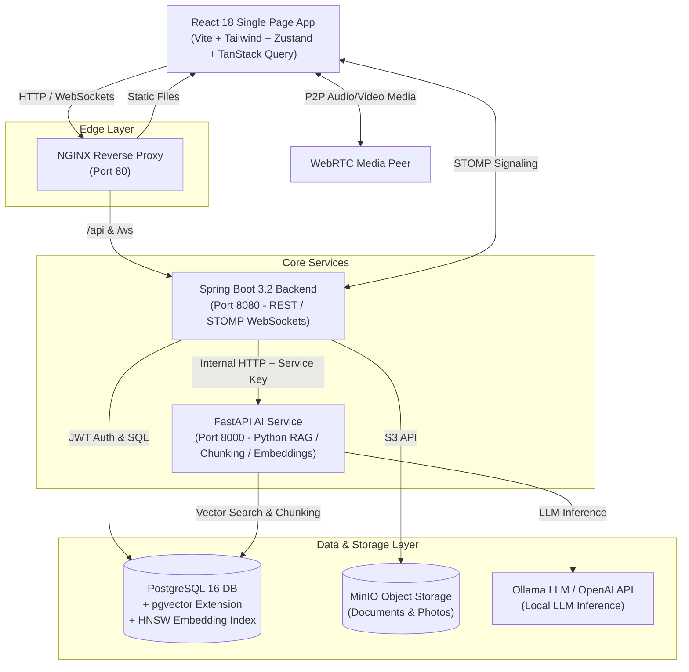

# System Architecture & Technical Specification

## 1. System Overview

The AI-Native CRM Platform is built around the fundamental core invariant:
> **ONE PROJECT = ONE ISOLATED KNOWLEDGE AND COLLABORATION SPACE.**

The application integrates real-time communications, project management, document storage, structured project memory, and a permission-aware Retrieval-Augmented Generation (RAG) assistant into an isolated multi-tenant workspace architecture.

---

## 2. High-Level Architecture Diagram



---

## 3. Data Storage & Vector Indexing Strategy

### Relational Schema (PostgreSQL 16)
- Managed via **Flyway Migrations (`V1__` through `V11__`)**.
- Every project-specific table (`tasks`, `conversations`, `messages`, `meetings`, `documents`, `memory_cards`, `document_chunks`, `source_records`) contains a mandatory foreign key constraint to `projects(id)`.
- `document_chunks` table includes a native `vector(384)` column for MiniLM-L6-v2 embeddings with an HNSW cosine similarity index:
  ```sql
  CREATE INDEX idx_document_chunks_embedding ON document_chunks 
  USING hnsw (embedding vector_cosine_ops);
  ```

### Document Ingestion Flow
1. **Upload**: User uploads PDF/DOCX -> Spring Boot validates extension, saves metadata to Postgres, stores raw file in MinIO (`bucket: project-{projectId}`).
2. **Indexing Request**: Spring Boot dispatches asynchronous HTTP payload to AI Service (`POST /api/ingestion/document`).
3. **Extraction & Chunking**: AI Service parses text, cleans whitespace, chunks text into ~500-token overlapping blocks.
4. **Vector Generation**: Generates 384-dimensional dense vectors using `sentence-transformers/all-MiniLM-L6-v2`.
5. **Database Storage**: Stores chunk text, vector embedding, `project_id`, and `visibility` in `document_chunks`.

---

## 4. Workload Limit Enforcement

To prevent employee burnout and maintain optimal capacity:
- **Maximum 3 Active Projects** per employee rule is enforced transactionally at both the Database and Application layers.
- DB Partial Unique Index:
  ```sql
  CREATE UNIQUE INDEX idx_unique_active_project_membership 
  ON project_memberships(user_id, project_id) WHERE is_active = TRUE;
  ```
- Spring Boot `ProjectService.addTeamMember()` executes with `SERIALIZABLE` transaction isolation / pessimistic lock checks before assigning membership.
